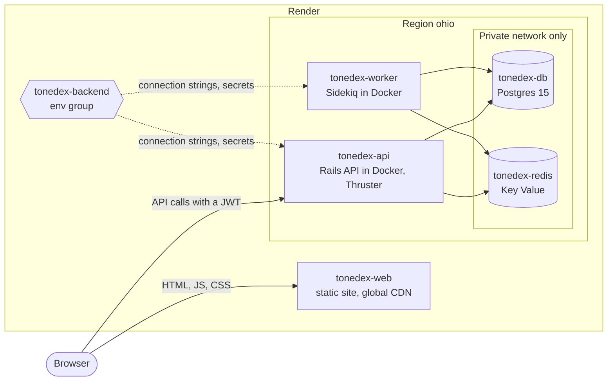

# ToneDex

A dex for the game you're actually playing. Pick a Pokémon game and browse its regional dex, with each Pokémon's moves and types as they are in that game.

**Live:** https://tonedex-web.onrender.com

## Features

- **Game-specific dex:** choose a game and scroll its regional dex, jump to any section of large dexes, and filter by type across the whole dex.
- **Detail pages:** types (accurate to the game's generation), base stats, abilities, flavor text, evolution chain, and the moves learnable in that game with their learn levels.
- **Search:** one game-aware search bar with autocomplete and sprites.
- **Compare:** two Pokémon side by side, with a shareable URL.
- **Team builder:** pick up to six Pokémon from the game's dex and see where the team is weak, what it resists, and the gaps in its offensive coverage.
- **Accounts:** sign in with Google to keep favorites (reorderable by drag or keyboard) and a caught tracker across devices.
- **Dark mode** and accessibility work: AA contrast on type badges, keyboard-operable controls, focus management on navigation.

## Screenshots


## How it works

- **Data comes from [PokeAPI](https://pokeapi.co/), fetched at most once.** Every response is cached permanently in Postgres, including not-found results, so the app never asks PokeAPI the same question twice.
- **Seeding is lazy.** The first visit to a game queues a Sidekiq job that crawls its dex; the page fills in as the job runs.
- **Sprites are self-hosted**, so fast scrolling never hits a third party's rate limits.
- **Two independent auth flows:** the SPA exchanges a Google ID token for a JWT, while the Sidekiq admin UI uses a server-side OmniAuth session restricted to one account.

[ARCHITECTURE.md](ARCHITECTURE.md) covers the system in detail, and [`docs/adr/`](docs/adr/) records the reasoning behind each major decision.

## Tech stack

- **Backend:** Ruby on Rails 8 (API-only), Sidekiq, PostgreSQL 15, Redis 7
- **Frontend:** React 19, TypeScript, Vite, TanStack Query, MUI with styled-components, React Router
- **Testing:** RSpec, Vitest, Playwright
- **CI:** GitHub Actions running linters, all three test suites, Brakeman and bundler-audit, a boot check of the production backend image, and Terraform fmt and validate
- **Dev environment:** Docker Compose
- **Hosting:** Render, declared in Terraform

## Running locally

Prerequisites: Docker with Docker Compose.

```bash
cp .env.example .env.local
docker compose up --build -d
docker compose exec backend bundle exec rails db:prepare
```

`db:prepare` creates the database and seeds the game list from PokeAPI. Then open:

- Frontend: http://localhost:5173
- API: http://localhost:3000

Browsing works with the placeholder values in `.env.example`. Google sign-in needs your own OAuth client ID in `.env.local`.

`VITE_API_URL` tells the SPA where the API lives: `http://localhost:3000` in development (the value in `.env.example`, and the fallback when it's unset) and `https://tonedex-api.onrender.com` in production, where Terraform sets it on the static site. Vite bakes it into the bundle at build time, so changing it means rebuilding the frontend.

## Tests

```bash
docker compose exec backend bundle exec rspec   # backend
docker compose exec frontend npm test           # frontend unit tests
cd frontend && npm run test:e2e                 # Playwright (API calls are mocked)
```

Playwright starts the Vite dev server itself (or reuses one already on :5173); it needs `npm ci` and `npx playwright install chromium` in `frontend/` first.

The backend suite has about 130 RSpec examples, the frontend about 55 Vitest tests, and the end-to-end suite about 40 Playwright tests.

## Deployment

Production runs on [Render](https://render.com) in the ohio region. Every resource is declared in Terraform under `infra/render` with the `render-oss/render` provider. [infra/render/README.md](infra/render/README.md) is the source of truth for how the stack is built, applied and torn down, and [ADR-008](docs/adr/008-render-via-terraform.md) records why.

- Frontend: https://tonedex-web.onrender.com
- API: https://tonedex-api.onrender.com



- **tonedex-api** builds the production stage of `backend/Dockerfile`. Thruster listens on `HTTP_PORT` 10000 and starts Puma behind it, `/up` is the health check, and `db:migrate` runs before each deploy.
- **tonedex-worker** runs `bundle exec sidekiq` from the same image.
- **tonedex-web** is the Vite build of `frontend/`, with a rewrite to `index.html` for deep links and the headers listed under Security.
- **tonedex-db** is PostgreSQL 15. **tonedex-redis** is a Key Value instance on the free plan with the `noeviction` policy, so Sidekiq jobs are never evicted. Neither accepts external connections.
- **tonedex-backend** is the env group the api and worker share: `DATABASE_URL`, `REDIS_URL`, the secrets, `CORS_ORIGINS` and `ALLOWED_HOSTS`.

Render deploys from `main`. The first production seed copied the development `api_caches` table into the production database, so seeding made no PokeAPI calls.

## Security

- **Authentication:** the SPA exchanges a Google ID token for a 30-day JWT, sent as a bearer token on authenticated calls. The Sidekiq UI uses a separate OmniAuth session restricted to one Google account.
- **CORS allowlist:** the API accepts cross-origin requests only from `CORS_ORIGINS` (the frontend URL in production), and production refuses to boot without it.
- **Host authorization:** production checks the `Host` header against `ALLOWED_HOSTS` and forces SSL with HSTS.
- **Rate limiting:** Rack::Attack throttles the API, auth and search routes per IP.
- **Static-site headers:** `X-Frame-Options: DENY`, `X-Content-Type-Options: nosniff`, `Referrer-Policy: strict-origin-when-cross-origin`, and a report-only Content Security Policy that logs violations in the browser console without blocking them. [infra/render/README.md](infra/render/README.md#content-security-policy) explains each source.
- **Private data stores:** Postgres and Key Value accept connections only from Render's private network.
- **Scanning:** CI runs Brakeman on the Rails code and bundler-audit on the gems for every pull request and push to `main`. GitHub secret scanning is on for the repository.

## Disclaimer

ToneDex is an unofficial fan project. It isn't affiliated with, endorsed by or sponsored by Nintendo, Game Freak, Creatures Inc. or The Pokémon Company. Pokémon and Pokémon character names are trademarks of Nintendo. Sprites and game data come from [PokeAPI](https://pokeapi.co/) and belong to their respective owners.

## License

The code is released under the [MIT License](LICENSE). The license covers the code only, not Pokémon names, sprites or data.
